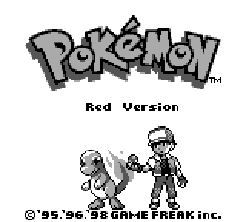
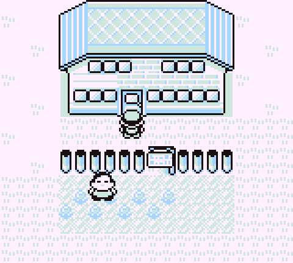
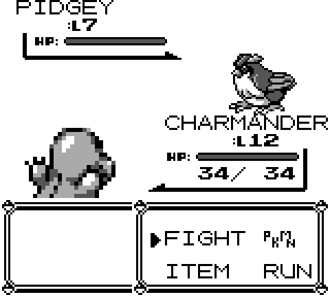
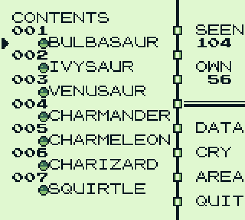
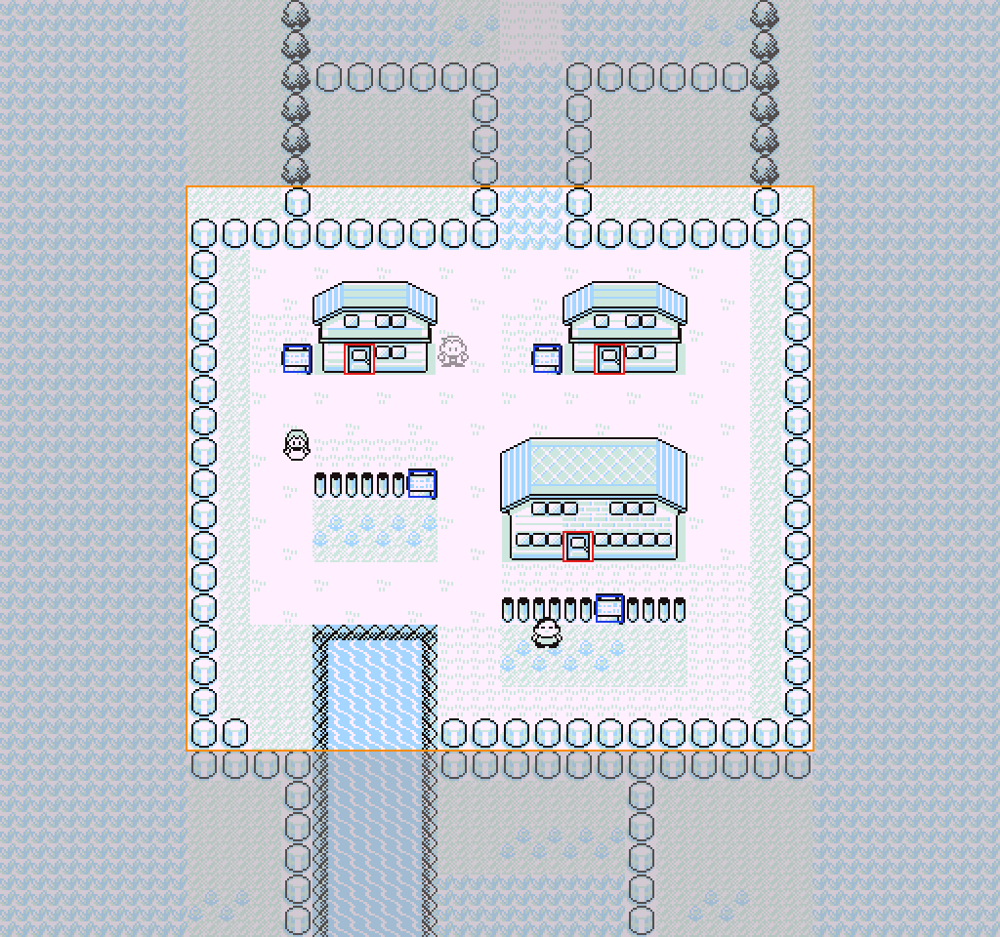

<p align="center">
  
</p>

<h1 align="center">Pokémon Red, running in your browser</h1>

<p align="center">
  The 1996 Game Boy game rebuilt from scratch in plain JavaScript.<br>
  No emulator, no plugins, nothing to install. A complete game as a web page.
</p>

<p align="center">
  <a href="https://brandeispatrick.github.io/pokemon-red-web/"><b>▶ Play it now</b></a>
  &nbsp;·&nbsp; <a href="#how-it-works">How it works</a>
  &nbsp;·&nbsp; <a href="#run-it-locally">Run it locally</a>
</p>

<p align="center">
  
  
  
  
</p>

## What you get

- **The whole game.** Every town, route, cave and building of Kanto. Eight gyms, Team Rocket,
  the Safari Zone, the Elite Four, the Hall of Fame and the credits.
- **Real battles.** All 165 moves and 87 move effects with the original damage, critical-hit,
  catch and experience formulas, including the famous Gen 1 bugs.
- **Everything around them.** Pokédex, party and stats screens, bag, PC storage, Marts,
  Pokémon Centers, trades, the Game Corner, Fly, Surf, Cut, Strength and Flash.
- **The original sound.** All 46 songs, 323 sound effects and 151 cries, played by a Game Boy
  sound chip synthesized in your browser.
- **Saves in your browser**, with CONTINUE on the title screen like the cartridge.
- **Plays on a phone**, with on-screen Game Boy controls and a home-screen install.

Controls on a keyboard: arrows move, <kbd>Z</kbd>/<kbd>Enter</kbd> A, <kbd>X</kbd> B,
<kbd>Shift</kbd> START, <kbd>Tab</kbd> SELECT. Sound starts on your first key press.

## How it works

| | |
|---|---|
| **Data, not a ROM** | Maps, tiles, sprites, text and music are converted from the game's published disassembly into JSON and PNG by the scripts in `tools/`. The browser loads them like any other web data. |
| **A Game Boy on a canvas** | `src/engine/` is a 160×144 four-shade framebuffer with a fixed 60 Hz loop. Palette fades, walking speed and text timing match the hardware frame for frame. |
| **The sound chip** | `src/audio/` synthesizes the Game Boy's four channels in an AudioWorklet and drives them with a port of the original sequencer, from the same note data as the cartridge. |
| **The world** | `src/overworld/` renders all 223 maps with the original collision, ledges, doors, map connections, NPCs, trainers and wild encounters. |
| **The battles** | `src/battle/` is the turn engine, trainer AI and battle screen; `src/battle_anims/` plays all 165 move animations from the original animation data. |
| **The story** | `src/game/scripts/` ports every map script from Pallet Town to the credits, on top of a generic hook API, with `src/menus/` and `src/intro/` providing the menus and the opening. |

<p align="center">
  
</p>

| 223 | 151 | 165 | 46 | 43k | 899 |
|:---:|:---:|:---:|:---:|:---:|:---:|
| maps | Pokémon | moves | songs | lines of JavaScript | automated tests |

## Run it locally

It is a static site, so any web server works. ES modules need a server; `file://` will not.

```bash
python3 -m http.server 8080
```

Open http://localhost:8080/. On a phone on the same Wi-Fi, open `http://<your computer's IP>:8080/`
and use Add to Home Screen for a full-screen app.

### Rebuild the data

The game data is generated from the `pret/pokered` disassembly and can be regenerated:

```bash
python3 -m venv .venv && .venv/bin/pip install pillow
git clone --depth 1 https://github.com/pret/pokered vendor/pokered
for t in maps pokemon font audio battle_anims events; do .venv/bin/python tools/extract_$t.py; done
```

### Tests

```bash
node --test 'tests/**/*.test.js'
```

### Deploy

`sh tools/build_dist.sh` assembles the deployable site in `dist/` (13 MB). Push it to any static
host; `tools/deploy_pages.sh` publishes it to GitHub Pages.

## Project layout

```
src/engine/        framebuffer, palettes, loop, input, font, text box, menus, scenes
src/audio/         Game Boy APU synth + sequencer port
src/pokemon/       species, moves, items, stats, damage, catching, experience, party, bag
src/game/          save state, hooks, story scripts (regions/kanto1..6.js)
src/overworld/     maps, movement, NPCs, trainers, encounters
src/battle/        battle engine and screen        src/battle_anims/  move animations
src/menus/         all menus, PC, Mart, Center     src/intro/         title, intro, naming
src/mobile/        touch controls and phone layout
tools/             Python extractors               docs/              design notes per module
```

## Known gaps

- Super Game Boy colours apply in the overworld only; battles and menus use the four shades.
- Link-cable trades and battles are not implemented.
- A few effects are simplified: Fly, Dig and Teleport are plain fades, the elevator shake is sound only.
- Verified in desktop Chrome and in phone emulation; real-device testing is ongoing.

## Credits and legal

A fan project for demonstration and education, built with Claude. Pokémon and all related
names, characters, artwork and music are trademarks and copyright of Nintendo, Creatures Inc.
and GAME FREAK inc. This project is not affiliated with or endorsed by them. Game data is
derived from the [pret/pokered](https://github.com/pret/pokered) disassembly.
